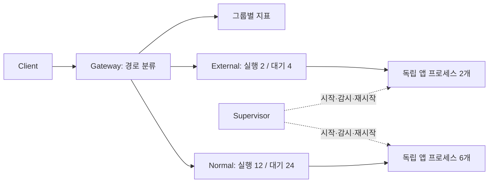

# IsolateX 프로젝트 초안

> 요청 유형별 서버 프로세스와 수용량을 분리하여, 특정 기능의 지연과 프로세스 장애가 다른 기능으로 번지는 것을 줄이는 단일 호스트 애플리케이션 런타임.

상태: 최초 설계 기록 · 작성일: 2026-10-23 · 실제 구현 현황과 실행법은 루트 README 참고. 이름은 가칭이며 공개 전 중복 확인 필요.

## 1. 해결할 문제

하나의 애플리케이션에서 ERP 연동이 느려지면 진행 중인 요청과 DB 연결이 쌓이고, 정상 기능까지 지연될 수 있다. IsolateX는 요청 경로를 기준으로 독립적인 프로세스 풀에 전달하고, 각 풀의 실행·대기 수와 장애 복구를 관리한다.

첫 사용자는 단일 서버에서 HTTP 애플리케이션을 운영하는 개발자다. 핵심 사용 흐름은 **앱 실행 명령과 경로별 예산을 설정 → IsolateX 실행 → ERP 장애 주입 → 일반 요청의 영향을 측정**하는 것이다.

검증할 가설: 동일한 총 프로세스 수와 부하에서, ERP 지연 또는 ERP 풀의 프로세스 장애가 발생해도 일반 요청의 성공률과 P95를 유지할 수 있다. CPU·메모리·DB 공유 자원 고갈은 별도의 실험으로 다룬다.

## 2. 제품 범위와 차별화 가설

Envoy Gateway에도 동시 요청과 대기 요청의 한도를 설정하는 기능이 있다. 프록시의 한도 제어만으로 차별화되지는 않는다. [공식 문서](https://gateway.envoyproxy.io/latest/tasks/traffic/circuit-breaker/)

IsolateX의 차별화 가설은 **하나의 설정과 실행 명령으로 요청 분류, 서버 프로세스 풀 생성, 재시작, 과부하 제어를 함께 제공하는 개발 경험**이다. 경쟁 제품에 없는 최초 기능이라는 주장은 하지 않는다. 직접 조합한 프록시와 프로세스 매니저 대비 설치·설정·장애 분석 절차가 얼마나 줄어드는지 확인한다.

| 포함 | 초기 제외 |
| --- | --- |
| 단일 호스트, Go 실행 파일 | 클러스터 스케줄러, 서비스 메시 |
| 경로 기반 HTTP 라우팅 | 함수 호출 가로채기, 코드 자동 분할 |
| 그룹별 프로세스와 요청 예산 | 오토스케일링, 무중단 설정 리로드 |
| 유한 대기열, 타임아웃, 재시작 | 자동 재시도, 영속 작업 큐 |
| CLI, 구조화 로그, 기본 지표 | 관리 웹 UI, 플러그인 시스템 |

프로세스 관리의 첫 지원 환경은 Linux로 한정한다. Windows에서는 WSL2로 검증하고, 네이티브 Job Objects 지원은 후속 과제로 둔다. 요청 프록시 단계는 이식 가능한 Go 코드로 작성한다.

## 3. 애플리케이션이 만족해야 하는 조건

- HTTP 서버로 실행되며, 환경변수 등으로 수신 포트를 바꿀 수 있어야 한다.
- 같은 앱을 여러 번 실행할 수 있어야 한다. 메모리 세션·로컬 상태 공유에 의존한다면 별도 변경이 필요하다.
- 프로세스마다 배치 작업, 마이그레이션, 스케줄러가 중복 실행되지 않도록 설정할 수 있어야 한다.
- 준비 상태를 나타내는 HTTP 엔드포인트를 제공해야 한다. 없다면 추가해야 한다.
- 요청 취소와 DB 쿼리 타임아웃은 앱 및 드라이버에서 처리해야 한다.

초기 방식은 **동일한 전체 앱을 여러 프로세스로 복제한 뒤 경로별로 트래픽을 분리**하는 것이다. 런타임이 앱 내부 코드를 자동으로 나누지는 않는다. 최소한 포트·준비 상태·시작 작업 설정 변경은 필요할 수 있다.

워커 포트는 loopback에 바인딩한다. 그룹 분류는 보안 경계나 접근 제어 기능이 아니며, 같은 사용자 권한으로 실행되는 프로세스를 악성 코드로부터 격리하지 않는다.

## 4. 런타임 구조



Gateway와 Supervisor는 하나의 IsolateX 프로세스에서 실행한다. 앱 워커는 자식 프로세스다. 둘을 별도 데몬으로 나누거나 관리 RPC를 추가하지 않는다.

| 용어 | 의미 |
| --- | --- |
| Bulkhead | 독립된 요청 예산과 워커 풀을 가진 논리 그룹 |
| Worker | HTTP 서버를 실행하는 OS 프로세스 하나 |
| Active | 해당 그룹에서 upstream으로 전달 중인 요청 수 |
| Queued | 전달 전 대기 중인 요청 수 |
| Ready worker | 준비 상태 확인을 통과해 신규 요청을 받을 수 있는 프로세스 |

`workers: 2`는 프로세스 두 개다. 각 프로세스는 여러 요청을 처리할 수 있으므로 `max_concurrent`와 다른 값이다. 그룹의 `max_concurrent`는 전체 워커에 걸친 합계이며, 초기 분산 방식은 준비된 워커 중 진행 요청이 가장 적은 워커 선택이다. 동률이면 순환 선택한다.

각 그룹은 별도 전송 연결 풀과 대기열을 갖는다. 그룹별 상태 잠금 안에서 네트워크 I/O를 수행하지 않는다. 다른 그룹으로 자동 우회하면 격리 예산이 무너지므로 우회하지 않는다.

## 5. 목표 설정 형식

아래는 **v0.2 목표 스키마**다. 아직 실행 가능한 설정은 아니다. v0.1은 관리자가 실행한 서버의 `upstreams` 목록을 사용하고, v0.2에서 아래의 관리형 프로세스를 추가한다. 한 그룹에서 두 모드를 혼용하지 않는다.

```yaml
version: 1
listen: "127.0.0.1:8080"
admin_listen: "127.0.0.1:9090"
max_admitted_requests: 256
max_body_bytes: 1048576
shutdown_grace: 10s

bulkheads:
  normal:
    match:
      path_prefix: /api
    process:
      command: ["./demo-app"]
      workers: 6
      port_start: 9100
      env:
        APP_POOL: normal
        DB_MAX_CONNECTIONS: "4"
    max_concurrent: 12
    queue_size: 24
    queue_timeout: 100ms
    request_timeout: 2s
    readiness:
      path: /readyz
      interval: 1s
      timeout: 300ms
      startup_timeout: 10s

  external:
    match:
      path_prefix: /api/erp
    process:
      command: ["./demo-app"]
      workers: 2
      port_start: 9200
      env:
        APP_POOL: external
        DB_MAX_CONNECTIONS: "2"
    max_concurrent: 2
    queue_size: 4
    queue_timeout: 200ms
    request_timeout: 5s
    readiness:
      path: /readyz
      interval: 1s
      timeout: 300ms
      startup_timeout: 10s
```

- 경로는 세그먼트 경계를 포함한 최장 prefix 일치로 분류한다. `/api/erp`는 `/api/erp`와 `/api/erp/orders`에 일치하고 `/api/erp-old`에는 일치하지 않는다. 같은 prefix 중복은 시작 오류, 불일치는 404다. query는 분류에 사용하지 않는다.
- 초기에는 정규식, 경로 재작성, 메서드 조건을 넣지 않는다. 모호한 인코딩 경로와 dot segment는 검증하여 400으로 거부하고, 분류와 upstream 전달이 서로 다른 경로 해석을 하지 않게 한다.
- 워커 `i`의 포트는 `port_start + i`다. 런타임이 `PORT`, `HOST=127.0.0.1`을 주입한다. 앱은 이 계약을 따라야 한다. `APP_POOL`과 `DB_MAX_CONNECTIONS`는 예제 앱이 해석하는 값이며 런타임이 강제하지 않는다.
- 배열 명령을 셸 없이 실행한다. 예약 환경변수 덮어쓰기, 포트 중복, 알 수 없는 키, 잘못된 duration, 음수 한도, `workers < 1`, `max_concurrent < 1`을 거부한다. `queue_size: 0`은 즉시 수용 또는 거부다.
- 포트 충돌과 자식의 조기 종료를 시작 실패로 처리한다. 준비 응답만으로 소유권을 추정하지 않고, 자식 생존과 포트 바인딩 실패 로그를 함께 검증한다.
- `request_timeout`은 그룹 진입부터 응답 본문 전달 종료까지의 전체 예산이다. 대기 시간도 포함한다. 대기 한도는 `queue_timeout`과 남은 전체 예산 중 짧은 값이다.

## 6. 요청 처리 계약

1. 헤더·본문 크기와 읽기 시간 제한을 적용하고 경로를 분류한다.
2. 전역 수용 한도를 확인한다. 그룹이 정상이며 Ready 워커가 있으면 그룹의 실행 슬롯을 얻거나 유한 FIFO 대기열에 들어간다.
3. 대기열이 꽉 차면 즉시 거부한다. 클라이언트 취소나 대기 만료 시 항목을 제거한다. 대기 중에는 본문을 전부 메모리에 읽어 두지 않는다.
4. 슬롯 배정 직전에도 취소·마감 시간을 재확인한다. 큐 항목의 취소와 배정 경합이 슬롯 누수를 만들지 않도록 상태 변경을 한 번만 확정한다.
5. Ready 워커로 전달한다. 응답 본문 종료, 전송 실패 또는 취소 시 슬롯과 전역 수용권을 정확히 한 번 반환한다.

| 상황 | 응답 또는 처리 |
| --- | --- |
| 전역/그룹 용량 초과, 대기 만료 | 503, 고정된 오류 코드로 원인 구분 |
| Ready 워커 없음, 차단기 Open | 503 |
| upstream 연결 실패 | 502 |
| 전체 요청 시간 초과 | 헤더 전송 전이면 504 |
| upstream이 반환한 응답 | 상태 코드와 본문 전달 |
| 클라이언트 연결 종료 | 전달 취소, 내부 결과로 기록 |

응답 헤더를 이미 보냈다면 상태 코드를 504로 바꿀 수 없다. 스트림을 종료하고 최종 결과를 로그와 지표에 기록한다. 전체 응답을 버퍼링해서 이 문제를 숨기지 않는다.

`max_admitted_requests`는 분류 이후 활성·대기 요청 수를 제한한다. TCP 연결 수와 헤더 파싱 전 비용까지 제한하지는 않는다. 서버 헤더 제한과 읽기 제한을 별도로 두고, 대량 연결 공격 방어는 초기 목표에서 제외한다. WebSocket, SSE, gRPC는 초기 지원 범위에서 제외한다.

**타임아웃은 앱 작업 중단 보장이 아니다.** upstream 요청을 취소해도 앱이 무시하면 작업이 남을 수 있다. 슬롯은 프록시가 추적하는 요청 수이며 실제 DB 작업 수가 아니다. 요청 하나가 느리다는 이유로 여러 요청을 처리 중인 워커를 죽이지 않는다. 데모는 앱의 취소 준수 여부를 나눠서 실험한다.

## 7. 프로세스 수명과 장애 복구

```text
Stopped → Starting → Ready → Draining → Stopped
               ↓        ↓
            Backoff ← Exited
```

- `exec.Cmd`로 워커를 실행하고 반드시 `Wait`로 수거한다. 프로세스 종료와 요청 타임아웃은 독립 사건으로 처리한다. Go 표준 라이브러리를 우선 사용한다. [os/exec 문서](https://pkg.go.dev/os/exec)
- Linux에서 워커별 OS 프로세스 그룹을 만들어 종료 신호를 보낸다. Bulkhead는 이 그룹 여러 개를 소유하는 논리 풀이다. 탈출한 자손까지 확실히 회수하는 보장은 cgroup 기반 수명 관리 단계에서 다룬다.
- 시작 준비 확인 전에는 트래픽을 보내지 않는다. 시작 제한 시간 초과 시 해당 워커를 정리하고 재시작 예산을 적용한다.
- 재시작은 워커별 지수 백오프와 jitter를 사용한다. 초기값 500ms, 상한 30s, 60초 동안 재시작 최대 5회다. 초과하면 Failed로 남겨 503과 관리 상태로 드러내며, 자동 반복을 멈춘다. 초기 수동 복구는 런타임 재실행이다.
- v0.2는 시작 준비 확인과 비정상 종료 감지를 구현한다. v0.3은 주기적 준비 확인을 추가하고, 연속 실패 워커를 트래픽에서 제외한다. 외부 ERP 장애를 프로세스 장애로 간주해 반복 재시작하지 않는다.
- 종료 시 신규 수용을 멈추고 대기 요청을 해제한다. 진행 요청을 최대 `shutdown_grace` 동안 기다린 후 자식 그룹에 SIGTERM, 짧은 유예 뒤 SIGKILL을 보내고 수거한다. 종료 중에는 재시작하지 않는다.
- IsolateX가 SIGKILL로 종료되면 정상 정리 절차는 실행되지 않는다. 초기 버전은 서비스 매니저의 전체 그룹 종료를 운영 전제로 문서화하고, 재기동 시 남은 포트를 발견하면 실패한다. 완전한 고아 프로세스 방지는 후속 cgroup 수명 관리의 검증 항목이다.
- stdout/stderr는 워커 ID와 그룹명을 붙여 내보내되 행 크기를 제한한다. 로그 소비 지연으로 앱이 멈추지 않도록 유한 버퍼와 초과 로그 집계·드롭 정책을 둔다.

Circuit Breaker는 v0.3에서 그룹별로 추가한다. 초기 규칙은 최근 10초 동안 완료된 전달 요청 20개 이상에서 실패율 50% 이상이면 Open, 5초 뒤 단일 Half-open 요청 허용이다. 성공이면 Closed, 실패면 Open으로 돌아간다. 실패는 연결 오류·upstream 타임아웃·upstream 5xx로 한정하고, 로컬 거부와 클라이언트 취소는 제외한다. 구현 시 슬라이딩 윈도 경계와 상태 전이를 명시적으로 테스트한다.

## 8. 격리 보장과 한계

| 자원 또는 장애 | 초기 버전의 효과 | 남는 한계 |
| --- | --- | --- |
| 실행·대기 요청 | 그룹별 상한 | 공유 Gateway 자체는 단일 장애 지점 |
| 앱 크래시 | 해당 워커의 요청과 용량에 영향 한정 | 호스트·런타임 장애는 전체 영향 |
| 앱 힙·GC | 프로세스마다 분리 | 호스트 메모리 고갈 방지 보장 없음 |
| CPU | 프로세스 분리 | OS CPU quota 없이는 경쟁 지속 |
| DB | 앱 설정으로 풀 크기 조절 가능 | 쿼리 경합·락·공유 DB CPU는 분리되지 않음 |
| 외부 API | 해당 그룹의 동시 호출 압력 제한 | 취소 무시 작업과 앱 내부 추가 호출은 별도 |

DB 연결 예산은 `각 그룹의 워커 수 × 워커별 최대 연결 수`의 합으로 계산한다. 예제는 `6×4 + 2×2 = 28`이며, 관리 연결과 다른 앱의 연결 예산은 별도다. 동일 DB의 락 경합까지 없앤다고 주장하지 않는다.

후속 Linux cgroup v2에서는 그룹별 CPU 대역폭과 메모리 상한을 다룬다. 컨트롤러 활성화와 권한 위임이 필요하므로 단순히 설정 키를 추가해서 끝나는 기능으로 보지 않는다. [Linux 공식 문서](https://www.kernel.org/doc/html/latest/admin-guide/cgroup-v2.html)

## 9. 구현 순서와 완료 조건

개인 프로젝트 기준 6~8주 계획의 예시이며 실제 일정은 주당 투입 시간에 맞춰 조정한다. v0.1은 학습·검증 단계이고, **포트폴리오 첫 완성 기준은 v0.2와 재현 가능한 장애 데모**다.

| 단계 | 산출물 | 완료 조건 |
| --- | --- | --- |
| 1주차: v0.1 라우팅 | 설정 검증, 정적 upstream, ReverseProxy | 경로 경계·중복·404, upstream 오류 처리 검증 |
| 2주차: v0.1 수용 제어 | 그룹별 실행 제한, 유한 큐, 전체 타임아웃 | 포화·취소·시간 초과·본문 전송 실패 후 누수 없음 |
| 3~4주차: v0.2 프로세스 | spawn, 시작 준비 확인, 재시작 예산, 종료 | 워커 강제 종료·포트 충돌·시작 실패·종료 중 재시작 금지 검증 |
| 5주차: v0.3 장애 복구 | 주기적 health check, Circuit Breaker | 상태 전이, probe 제한, 회복 데모 검증 |
| 6주차: v0.4 관측 | Prometheus, 반복 벤치마크, 문서 | 동일 조건 재현 명령과 결과 공개 |
| 7~8주차: 여유 | 경쟁 조건 수정, 사용성 개선 | Linux에서 race 검사와 종료 누수 검사 통과 |

측정이 개발 말기에 몰리지 않도록 요청·거부·대기·재시작의 구조화 로그와 내부 카운터는 v0.1부터 둔다. Prometheus 공개 형식만 v0.4에서 정리한다.

구현은 `net/http`, `net/http/httputil`, `context`, `os/exec` 중심으로 한다. YAML 파싱은 검증된 파서를 사용하고, 단순한 CLI에 별도 프레임워크를 붙이지 않는다. 프록시는 표준 `ReverseProxy`를 활용한다. [Go 공식 문서](https://pkg.go.dev/net/http/httputil#ReverseProxy)

초기 폴더는 `cmd/isolatex`, `internal/config`, `internal/gateway`, `internal/supervisor`, `examples/demo-app`, `bench` 정도로 시작한다. 실제 경계가 필요해질 때만 패키지를 더 나눈다.

## 10. 성능과 장애 실험

첫 데모는 DB 없이 일반 응답과 취소 가능한 외부 지연을 제공하는 작은 앱으로 만든다. 이후 CPU 점유와 실제 DB 경합을 추가하여 보장 범위를 구분한다.

### 비교군

1. A: 같은 Gateway를 통과하고 모든 경로가 공유 풀을 사용한다.
2. B: 같은 Gateway에서 경로별 실행·대기 예산만 나누고 프로세스 풀은 공유한다.
3. C: 경로별 예산과 프로세스 풀을 모두 나눈다.

A→B는 요청 수용 제어 효과, B→C는 프로세스 장애 격리 효과를 관찰한다. 총 프로세스 수, 전체 실행·대기 예산, DB 연결 예산, 하드웨어, 앱 빌드와 부하는 동일하게 맞춘다. 위 설정에서는 A/B도 총 8개 프로세스를 사용한다. 원래 아이디어의 Heavy 풀은 첫 데모에서 제외하고 두 풀로 검증한다.

### 실험 절차

- 정상 부하에서 포화 지점을 먼저 찾고, 일반 요청의 목표 부하는 장애 전부터 일정하게 유지한다.
- 30초 준비 → 60초 정상 → 60초 ERP 장애 → 60초 회복을 한 실행으로 한다. 비교군 순서를 바꾸어 최소 5회 반복한다.
- 고정 도착률 부하를 사용한다. 부하 생성기의 목표·실제 전송률과 생성 실패도 기록해 서버가 느려질 때 요청 생성 자체가 줄어드는 착시를 피한다.
- 장애는 긴 ERP 응답, ERP 프로세스 비정상 종료, 취소 무시 작업을 각각 실행한다. CPU 점유와 DB 락 경합은 별도 한계 실험이다.
- 일반/ERP 각각의 성공 요청 P50·P95·P99, 성공 처리량, 거부율, 타임아웃률을 함께 보고한다. 거부 응답이 빠르다는 이유로 전체 P95가 좋아 보이지 않도록 성공·거부·실패를 분리한다.
- 복구 시간은 장애 제거부터 일반 요청의 10초 구간 P95와 성공률이 목표를 3개 구간 연속 만족할 때까지다. 워커 Ready 복귀 시간은 별도 기록한다.

### 잠정 성공 기준

초기 목표이며 측정 결과가 아니다. 기준 부하를 결과와 함께 명시한다.

- ERP 지연 실험에서 C의 일반 요청 성공 P95가 C의 정상 구간 대비 1.2배 이내, 성공률 99% 이상, 성공 처리량은 정상 구간의 95% 이상.
- ERP 워커 종료 시 일반 워커의 PID와 준비 상태 유지, 일반 요청에 같은 목표 적용.
- 모든 그룹의 active/queued가 설정 한도 이내이며 반복 취소·종료 후 슬롯·프로세스 누수 없음.
- CPU·DB 공유 자원 실험에서 위 목표를 못 맞추면 원인과 한계를 공개한다. cgroup 도입 전 CPU 보호를 성공 조건으로 주장하지 않는다.

## 11. 관측 지표

그룹명과 고정된 결과 코드만 주요 label로 사용한다. URL·사용자 ID·매번 바뀌는 PID를 시계열 label에 넣지 않는다.

| 지표 | 타입 / 용도 |
| --- | --- |
| `isolatex_requests_total{group,outcome}` | Counter / 성공·거부·upstream 오류·시간 초과·취소 |
| `isolatex_active_requests{group}` | Gauge / 전달 중 요청 |
| `isolatex_queued_requests{group}` | Gauge / 대기 수 |
| `isolatex_request_duration_seconds{group,outcome}` | Histogram / 큐 포함 처리 시간 |
| `isolatex_queue_duration_seconds{group,outcome}` | Histogram / 배정·거부·취소까지 대기 시간 |
| `isolatex_worker_restarts_total{group}` | Counter / 재시작 횟수 |
| `isolatex_ready_workers{group}` | Gauge / 현재 수용 가능 워커 |
| `isolatex_breaker_state{group}` | Gauge / 0=Closed, 1=Open, 2=Half-open |

관리 포트는 loopback 전용이다. `/healthz`는 런타임 생존, `/readyz`는 모든 구성 그룹의 수용 준비 여부, `/metrics`는 지표를 제공한다. 한 그룹이 불건강해도 다른 그룹 라우팅은 계속한다. 전체 readiness를 외부 로드밸런서에 연결할 경우 정상 그룹까지 제외될 수 있으므로 초기 단일 호스트 데모에서는 관측용으로 사용한다.

## 12. 첫 개발 작업

첫 PR은 **설정 읽기 → 두 경로 분류 → 이미 실행 중인 두 서버로 프록시 → 포화 시 503**까지만 구현한다. 다음 PR에서 유한 대기와 취소 경합을 다룬다.

첫 체크리스트는 세 가지다. `/api/erp-old`가 ERP로 분류되지 않을 것, ERP 요청이 포화되어도 일반 요청이 처리될 것, 취소와 슬롯 배정이 겹쳐도 한도가 복구될 것. 이후 Supervisor를 추가해 프로세스 분리의 효과를 같은 데모에서 비교한다.

이 초안에는 실행 코드나 실측 성능 결과가 포함되어 있지 않다.
